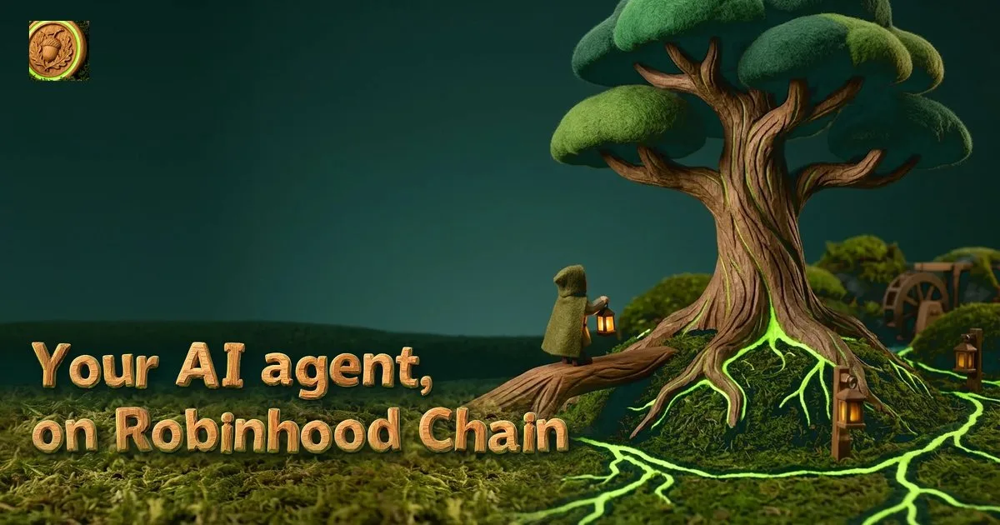

# Oak Agent Kit

Oak connects your AI agent to **34 projects on Robinhood Chain** through one
local MCP server. Your agent can check balances, compare swap routes, manage
vault and lending positions, bridge assets, and use project tools from the same
connection. MCP is the standard that lets an AI app call external tools.

Oak creates a wallet on your computer. The hosted service supplies quotes,
prices and unsigned transactions; the add-on checks, signs and sends locally.
Before signing, the agent prepares a summary and asks for a yes or no in chat.
Oak is independent and is not affiliated with Robinhood.

[](https://www.npmjs.com/package/@oakagentkit/addon)
[](LICENSE)

**Version 0.3.0 is published on npm** for `@oakagentkit/core` and
`@oakagentkit/addon`, plus the optional `@oakagentkit/gloam` engine. See the [changelog](CHANGELOG.md) for the fixes in this release.
Oak is free to use. Mainnet uses the [deployed contracts](contracts/deployments/README.md).

[Website](https://oakagentkit.org) · [Setup guides](docs/client-setup/README.md) ·
[Tool reference](docs/mcp-tools-reference.md) · [Security](docs/security.md) ·
[Access and fees](docs/access-and-pricing.md)

## Install

You need Node.js **22.12.0 or newer**, npm and an MCP client.
Run these commands in your terminal:

```sh
npm install -g @oakagentkit/addon
oak --version
```

Version 0.3.0 is available.
Run `oak --version` to check your installed version.

## Connect your agent

Run `oak connect claude` (or `codex`, `cursor`, `gemini`, `grok`) in your terminal
to see the connection instructions for your app. For a project connection, open
your terminal in that project folder first. Follow the instructions, then restart
your app and start a fresh session.
If Oak is already connected, keep that connection or remove it before adding
another. Connecting tools does not authorize identity registration or transactions.

### Claude Code

After the global install, run:

```sh
claude mcp add oak -- oak mcp
claude mcp list
```

Alternatively, use the [Claude Code plugin](docs/client-setup/claude-code.md):

```text
/plugin marketplace add OakAgentKit/oak
/plugin install oak@oak-agent-kit
```

The plugin runs `npx -y @oakagentkit/addon@0.3.0 mcp`; it does not need a global
Oak install. Restart Claude Code and check `/mcp` for `plugin:oak:oak`.

### Codex

Add this section to `~/.codex/config.toml` after the global install:

```toml
[mcp_servers.oak]
command = "oak"
args = ["mcp"]
```

Start a new session and ask for `account` and `balances`.
[Full Codex guide](docs/client-setup/codex.md)

### Cursor

After the global install, add Oak in **Cursor Settings → MCP**, using this
configuration in `.cursor/mcp.json`:

```json
{
  "mcpServers": {
    "oak": { "command": "oak", "args": ["mcp"] }
  }
}
```

[Add to Cursor](https://cursor.com/install-mcp?name=oak&config=eyJjb21tYW5kIjoibnB4IiwiYXJncyI6WyIteSIsIkBvYWthZ2VudGtpdC9hZGRvbkAwLjMuMCIsIm1jcCJdfQ%3D%3D) · [Install in VS Code](https://vscode.dev/redirect?url=vscode%3Amcp%2Finstall%3F%257B%2522name%2522%253A%2522oak%2522%252C%2522command%2522%253A%2522npx%2522%252C%2522args%2522%253A%255B%2522-y%2522%252C%2522%2540oakagentkit%252Faddon%25400.3.0%2522%252C%2522mcp%2522%255D%257D)

These shortcuts run the pinned 0.3.0 package through `npx`.
[Cursor guide](docs/client-setup/cursor.md) ·
[Claude Desktop](docs/client-setup/claude-desktop.md) ·
[Other clients](docs/client-setup/generic-mcp.md)

### First use

Ask your agent:

> Call account and tell me my public wallet address and network. Then check
> balances and positions. Explain any unavailable service results.

Oak creates the wallet automatically on first use. On first run, the agent asks
once whether you want a daily spending limit in USD; skipping leaves no limit,
and you can set or change it anytime in chat (`oak_spending_limit`). Fund the
wallet address with ETH for network fees, then re-check `balances`.
Oak is free to use. Reads work without an identity. Actions require a verified
ERC-8004 identity (except the free `gloam_claim` action). Approve public identity
registration separately; registration costs ETH gas.
Linking an existing identity is gasless. An external owner signs the link in
their own terminal. [Setup and access](docs/client-setup/README.md)

## What your agent can do

| Task | Projects on Robinhood Chain mainnet |
| --- | --- |
| Swap, trade, launch tokens and manage liquidity | KyberSwap, Velora, Pons, pools.trade, Clanker, Hookr, TickerSpring, Uniswap liquidity (v3/v4) |
| Pay privately | Gloam (optional local engine) |
| Use AI models, web search and page reading | Raeto |
| Find paid work and deliver it | Factor |
| Read workflow checkpoints, recovery history and Upoch Scores | Upoch |
| Use vaults and claim rewards | Steakhouse, Spark, NetNet, Longbow, Grove, Beefy, Merkl, Chop |
| Supply collateral, lend, borrow and repay | Morpho Blue, Priors, LayerBank, Borro |
| Buy, sell and redeem principal tokens | Pendle |
| Bridge assets | Relay |
| Use prediction markets, funding data and research | Meridian, Lighter, HeyResearch, Wormhole (Agent Wormhole) |
| Manage identity, names, locks and AI credits | ERC-8004, hood.ag, HoodLock, Orbio |

`earn_options` compares LayerBank and Pendle through a read-only helper.
It is excluded from the project count.

The mainnet module manifest has 694 shared tools; the server has 695 tools including the server-only `oak_keyed_read` transport. There are 35 module factories and 34 projects, excluding the read-only `earn_options` helper.

The catalog has **737 mainnet tools** and **50 testnet tools**. Your agent sees
23 core tools on mainnet, or 17 on testnet, in `tools/list`, plus installed recipes. It can find and
run the rest through `find_tool`, `run_read_tool`, and `run_tool`.
The [tool reference](docs/mcp-tools-reference.md) lists every tool and its inputs.
The [project guide](docs/robinhood-chain-projects.md) explains each integration.

For example, ask your agent to compare swap routes and show the preview before
signing, list vault positions, or find a project's available tools.
Actions depend on project availability, permissions and access checks. The
catalog is not a guarantee that every action is available to every wallet or
validated end to end.

Mainnet is chain **4663**. Testnet **46630** has basic and identity tools, without
swap routes or the other ecosystem modules. Token amounts use decimal base-unit
strings: `"10000000"` is 10 USDG with 6 decimals.

Merkl tools: Powered by Merkl, [app.merkl.xyz](https://app.merkl.xyz).
HeyResearch reads run on request and retain attribution and citations.
Gloam is an official Oak partner. Gloam's own team runs its product and contracts; Oak didn't build them and doesn't run them. Borro is an official Oak partner. Borro's own team runs its product and contracts; Oak didn't build them and doesn't run them. Oak x Chop. Chop's own team runs its product and contracts; Oak didn't build them and doesn't run them. Agent Wormhole is an official Oak partner. Agent Wormhole's own team runs its product and contracts; Oak didn't build them and doesn't run them. Agent Wormhole checks signed token metadata snapshots and request-time verdicts on chain 4663 and scans supplied text offline; neither read proves safety or sellability.

[](https://heyresearch.xyz/project/oakagentkit?utm_source=badge&utm_medium=readme)

Factor is an official Oak partner. Factor's own team runs its product and contracts; Oak didn't build them and doesn't run them.

Oak integrates with Raeto. Raeto's own team runs its product and contracts; Oak didn't build them and doesn't run them.

### Upoch

`upoch_agent` and `upoch_explorer` are mainnet-only reads. Read workflow roles, checkpoints, recovery history and on-chain Upoch Scores; browse a bounded ranked workflow list. Upoch is a project Oak reads from. The Upoch Score measures recovery policy and checkpoint activity from on-chain facts; it does not rate trading performance or safety.

## Access and fees

Oak is free to use, and installing the npm packages is free under their [package license](LICENSE-PACKAGES.md).
Read tools need no identity. Hosted actions require a verified ERC-8004 identity (except the free `gloam_claim` action).
Call `account` to check your wallet address, network, and ERC-8004 identity status.

Oak takes a 0.25% fee on swaps and bridges, plus partner referral fees:

- **Swaps and bridges:** 0.25% (`25 bps`) on KyberSwap swaps, Velora swaps, and Relay bridges and swaps.
- **hood.ag:** 5% referral fee on `.hood` registrations and 4% on marketplace resales, with matching buyer discounts (zero on treasury self-referral).
- **Borro:** Bookrunners referral partner (`10%` of the Borro vault interest fee on tagged deposits — `100%` of that share to Oak for the first 12 months, then `50%`, paid monthly in USDG, routed via `BorroBuilders` `0x082Ae609bdC7ccEec0C58B2361a21c49dc2aE291` with code `oak` and on-chain `minShares` or direct vault fallback).

ETH gas and project fees are separate.

25% of Oak's income buys back and burns `$OAK`. Holding `$OAK` has no access perks. Oak uses 25% of its income to buy back and burn `$OAK`. [Full access and fee details](docs/access-and-pricing.md) ·
[Website pricing](https://oakagentkit.org/pricing.html)

<a id="before-anything-signs"></a>

## Security model

Your key stays on your computer. The server never receives it and never signs
or sends a transaction. Swaps and deposits go straight from your wallet to the
project.

Before signing, Oak checks routes, recipients, approval spenders and simulated
wallet outflows. It refuses unlimited and incremental approvals, unsupported
permits and blanket operator approvals. Uniswap v4 liquidity adds default to 0.5% headroom (rounded up to the next base unit) within caller caps to tolerate small price ticks; new mints can request up to 5% with `slippageBps`, `exactCaps` mints approve the caller caps exactly, and unused ETH is refunded in the same transaction. A finite capped approval can leave an allowance that needs
cleanup; Oak makes no unconditional zero-residual-allowance promise.

The agent asks for a yes or no in chat before signing (calling a listed common action tool or `oak_prepare` with `{"name": "<tool>", "arguments": {...}}` builds and simulates the action without signing, showing what leaves your wallet, what comes back, the destination contract, the exact approval, the estimated network fee, the USD value, `actionId`, and UTC expiry; after you say yes, `oak_execute` with `{"actionId": "<the exact actionId>"}` re-simulates, checks that terms have not worsened and the optional daily spending limit in USD, and signs locally). Declining or letting `actionId` expire stops signing. You can set or change an optional daily spending limit in USD in chat (`oak_spending_limit`; asked once on first run, and skipped means no limit). Oak sets no operator token allowlist.

Previews estimate transfers; they do not prove sellability or off-chain
settlement such as Relay destination fills or Meridian relayer execution.
Gas is separate. Your computer, RPC and external projects remain trust
boundaries. There is no completed third-party audit.

One owner key controls treasury funds and contract administration, including
the price signer on `OakOracle` and `OakBurner`. Legacy v1 and v2 billing contracts (`0xF1C5d40997e1151B125a41e822C4278b153c4610` and `0x5e0d93D4bad53388839Ac5A53dB716b70d8606A8`) remain deployed on Robinhood Chain and are unused. There is no second-signature requirement. Compromise exposes those
powers; loss can make funds and administration inaccessible. It cannot spend
user wallet balances. [Authority details](docs/security.md#4-keys-and-authority-matrix)

Never give an agent keys or recovery words. Never let an agent run `oak init` or
`oak export`; those commands belong in your own terminal. Backups are optional:
`oak backup` gives guidance. Oak cannot recover a lost key. Oak shows a region
notice by default; the operator and user are responsible for local compliance.
[Security and custody](docs/security.md)

## Source and links

This repository contains MIT-licensed docs, examples and contracts.
The compiled npm packages have their [own license](LICENSE-PACKAGES.md);
their implementation source and the hosted service are private.
Contract source, tests, ABIs and deployment scripts are in [contracts/](contracts/).
The [deployment record](contracts/deployments/README.md) lists live addresses.
The [offline examples](examples/README.md) run with fixture data.

[What is Oak?](docs/what-is-oak.md) · [Examples](examples/README.md) ·
[Contract setup](docs/contract-development.md) · [Changelog](CHANGELOG.md) ·
[Contributing](CONTRIBUTING.md) · [Code of Conduct](CODE_OF_CONDUCT.md) ·
[Report a vulnerability](SECURITY.md) · [Website](https://oakagentkit.org) ·
[@OakAgentKit](https://x.com/OakAgentKit)


Gloam is opt-in. Install its optional engine beside the add-on to use private USDG payments:

```sh
npx -y -p @oakagentkit/addon@0.3.0 -p @oakagentkit/gloam@0.3.0 oak mcp
```

The default MCP command keeps the add-on alone. Gloam tools remain discoverable without the engine and give this install command when called. Only shield deposits sign wallet transactions. Pay, claim and cash-out make proofs locally for Gloam's relay; every action requires human confirmation, including free claims. Never paste a note or key into an agent. Back up Gloam notes with `oak export` in your own terminal; backups cover only the notes present when made.
