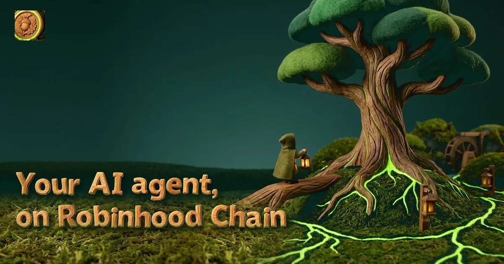
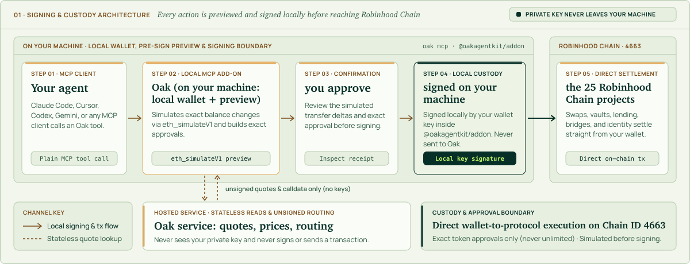
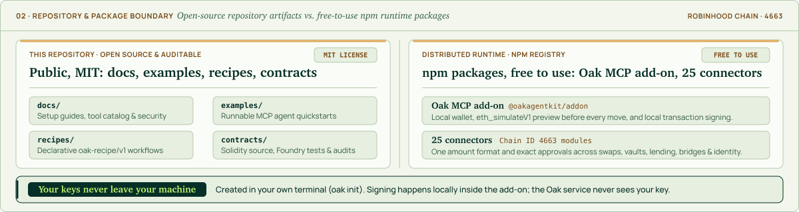

# Oak Agent Kit

**One install connects your AI agent to 25 Robinhood Chain projects: swap, lend, borrow, use vaults, launch tokens and pull research.**
Your keys stay on your machine. By default, Oak shows every transaction in plain words and waits for your approval before it signs.
Oak is independent and is not affiliated with Robinhood.

[](https://www.npmjs.com/package/@oakagentkit/addon)
[](LICENSE)
[](#quick-start-for-builders)
[](docs/robinhood-chain-projects.md)

[What is Oak?](docs/what-is-oak.md) · [Connect your agent](docs/client-setup/README.md) · [All 25 projects](docs/robinhood-chain-projects.md) · [Tool reference](docs/mcp-tools-reference.md) · [Security](docs/security.md)

## How it works

1. **Connect your agent.** Install Oak and add it to your AI app. Oak creates a local wallet automatically.
2. **Ask for what you need.** Look up a project, check balances, compare routes or prepare an action.
3. **Review, then confirm.** Oak checks the transaction locally and shows what it would do. By default, you confirm before it signs on your machine.

<p>
<a href="assets/arch-light.svg"><picture>
  <source media="(prefers-color-scheme: dark)" srcset="assets/arch-dark.svg">
  
</picture></a>
</p>

**Version 0.1.2:** 102 tools on mainnet, 16 on testnet. There is no send tool in this version.
Longbow deposits, reads and withdrawals are available. Meridian buys are coming soon:
Oak refuses them before anything is signed. Hosted actions open with the subscription contracts;
until their addresses are published in [contracts/deployments](contracts/deployments/README.md), they stay limited to the Oak team.

## 25 projects, one connection

| Category | Projects on Robinhood Chain mainnet |
| --- | --- |
| Swap & Trade | KyberSwap, Velora, Pons, pools.trade, Clanker, Hookr, TickerSpring, Uniswap liquidity (v3/v4) |
| Vaults & Rewards | Steakhouse, Spark, NetNet, Longbow, Grove, Beefy, Merkl |
| Borrow & Lend | Morpho Blue, Priors |
| Move Money | Relay |
| Markets & Data | Meridian, Lighter, HeyResearch |
| Identity & Tools | ERC-8004, hood.ag, HoodLock, Orbio (AI compute credits) |

- Read balances and positions across projects, look up tokens, and request project research.
- Compare swap routes, manage vault positions, bridge assets, and use names and agent identities.
- Launch tokens through Pons or Clanker, and trade Pons tokens before graduation.
- Build your own agent workflows, including owner-configured autonomous setups.

Actions depend on project availability and permissions, identity, and subscription access.
The catalogue describes configured tools, not a guarantee that every project action is
available to every wallet or validated end to end.
Merkl tools: Powered by Merkl, [https://app.merkl.xyz](https://app.merkl.xyz).
HeyResearch tools retain their attribution and citations.

## Quick start for builders

Requires **Node.js 22** (`>=22.12.0 <23`) and an MCP client.
These are the same install and connect commands as the [client guides](docs/client-setup/README.md):

```sh
npm install -g @oakagentkit/addon
oak --version
```

For Claude Code:

```sh
claude mcp add oak -- oak mcp
claude mcp list
```

For clients using MCP JSON:

```json
{
  "mcpServers": {
    "oak": { "command": "oak", "args": ["mcp"] }
  }
}
```

[Claude Desktop](docs/client-setup/claude-desktop.md) · [Cursor](docs/client-setup/cursor.md) · [Codex](docs/client-setup/codex.md) · [Gemini](docs/client-setup/gemini.md) · [Other clients](docs/client-setup/generic-mcp.md)

Start with a read:

> Call account and tell me my public wallet address and network. Then check balances and positions. Explain any unavailable service results.

Wallet creation needs no `oak init` step. The [offline examples](examples/README.md) run without hosted access.
Fund the returned address with ETH for network fees and USDG for subscriptions,
then re-check `balances`. Obtain permission for public identity registration and recurring payments.
[Setup and access](docs/client-setup/README.md) explains the full sequence.

Pass token amounts as decimal base-unit strings: `"10000000"` means 10 USDG
(6 decimals). Mainnet is `4663`; testnet `46630` has basic and identity tools,
without swap routes or the other ecosystem modules.

## Before anything signs

**Local checks:** The add-on checks swap routes against the locally held quote,
including tokens, exact input, recipient and minimum output. Other actions check
module destinations and approval spenders against local deployment definitions,
and simulated wallet outflows against requested inputs and public chain reads.
Swaps approve the quoted input and holder sign-up approves the quoted burn. A
bounded-price flow may approve a finite capped maximum and then request cleanup;
Oak makes no unconditional zero-residual-allowance promise. Unlimited and
incremental grants, unsupported permits, and blanket operator approvals are refused.
Transaction paths require successful `eth_simulateV1` results with complete logs and
transfer estimates. When `debug_traceCall` is supported, Oak also checks nested
delegate targets; an explicitly unsupported tracer selects simulation-only mode with
that residual risk. Malformed results and transport failures stop signing.

**Your confirmation:** The default `confirm ask` uses your client's confirmation
form. It shows simulated transfers, approvals, destination contracts, native value,
gas limit and maximum gas cost. Approval binds to the exact transaction or typed
action signature. Decline, cancel, timeout or an unavailable form stops signing.
The bridge may reuse an identical hosted preview from the same block for up to 12
seconds, but the local sender still simulates the ordered transaction sequence and
freshly simulates the exact transaction after confirmation. It refuses changed
transfers, approvals, missing logs or a revert before signing. Gasless identity-link
and RFQ continuations bind and confirm their EIP-712 typed data instead of pretending
to have an EVM transaction preview.

Reads and session authentication do not prompt. Subscription payments and renewals
can prompt. Only the owner should select `oak config set confirm auto` in their
own terminal for unattended operation; auto skips prompts and retains local checks.
Clients without MCP form elicitation cannot sign in default ask mode.

**Limits:** A preview is an estimate, not a promise of execution or sellability.
Transfer traces exclude gas; the confirmation shows gas separately. Checks do not
prove Relay destination fills or Meridian relayer execution. Oak adds no daily
spending caps or operator asset policy. Your computer, RPC and external projects
remain trust boundaries. There is no completed third-party audit.

Keep keys out of agent chats and logs. Backups are optional: `oak backup` gives
guidance; run `oak export` or recovery only yourself in your own terminal.
Oak cannot recover a lost key. [Security, custody and reporting](docs/security.md)

## Access

No-hold access starts at **12.333333 USDG per 30 days** during the launch curve.
The holder plan opens after graduation and 30 minutes of pool history:
**9 USDG per 30 days**, an OAK holding requirement and a one-time 5% sign-up burn.
Both plans wait during that 30-minute warmup. ETH network and project fees are separate.
Oak charges no per-call fee or additional trade fee. Holding OAK buys access and nothing else.
[Plans, renewal and cancellation](docs/access-and-pricing.md)

## Source, license and verification

<p>
<a href="assets/boundary-light.svg"><picture>
  <source media="(prefers-color-scheme: dark)" srcset="assets/boundary-dark.svg">
  
</picture></a>
</p>

The hosted service builds unsigned transactions; the add-on checks, signs and
broadcasts locally. Swaps and deposits go from your wallet to the project.
Subscriptions split 25% to `OakBurner` and 75% to the single-owner treasury.
One owner key controls treasury and contract administration; it cannot spend
user wallet balances. [Authority details](docs/security.md#4-keys-and-authority-matrix)

Public docs, examples and contracts use [MIT](LICENSE). The published
`@oakagentkit/core` and `@oakagentkit/addon` packages are free to use under their
[own license](LICENSE-PACKAGES.md); their implementation source and the hosted service are private.
Contract source, Foundry tests, ABIs and deployment scripts are in [contracts/](contracts/);
deployed addresses are published in [contracts/deployments](contracts/deployments/README.md) as each contract goes live.
Report vulnerabilities privately through [SECURITY.md](SECURITY.md).

[Examples](examples/README.md) · [Contract setup](docs/contract-development.md) · [Changelog](CHANGELOG.md) · [Contributing](CONTRIBUTING.md) · [Code of Conduct](CODE_OF_CONDUCT.md) · [Security](SECURITY.md) · [Oak website](https://oakagentkit.org) · [@OakAgentKit](https://x.com/OakAgentKit)
