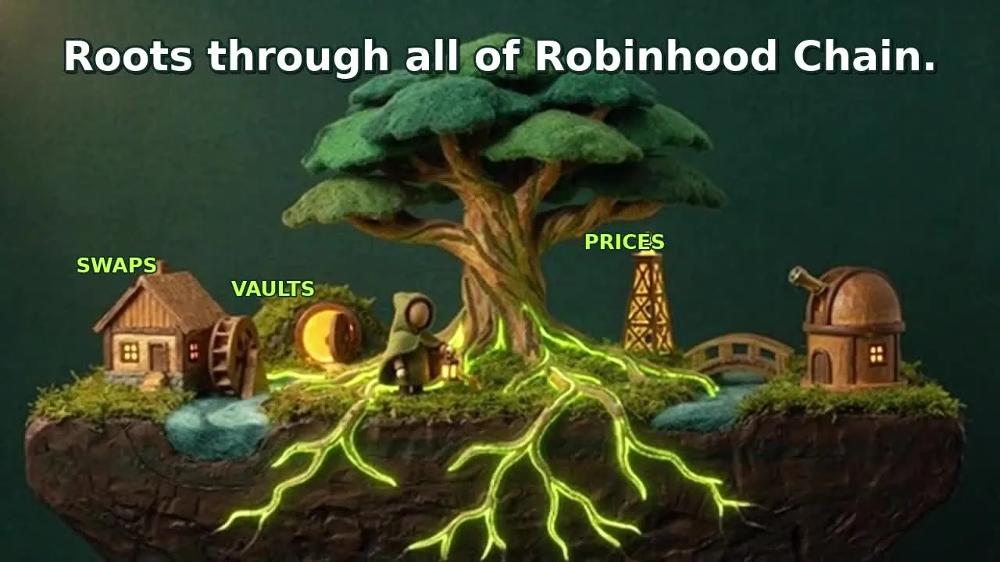

# What is Oak?

Oak gives your AI agent one connection to explore and use 35 configured projects on Robinhood Chain.
You can ask it to check balances, look up project information or prepare an action,
without connecting each project separately.

The illustration represents those configured integrations, not every project on the chain.

## Who it is for

If you use an AI app, Oak lets that app work with blockchain tools through a local
connection called MCP — an agent tool connection. You still decide which actions to approve.
If you build agents, the same connection gives you 753 mainnet tools in version 0.3.4 with consistent inputs
and one local wallet. You can build your own agent workflows; every action still needs approval in chat.
Version 0.3.4 shows your agent a short list of everyday tools; it finds and runs
any other tool with `find_tool` and `run_tool`.

The tree's roots connect the village in our artwork. Oak plays that connecting role
for the [35 configured projects](robinhood-chain-projects.md), including swaps, vaults, bridging,
research, names and agent identities. Pons token launches are one example.

## Your first five minutes

1. **Install and connect.** Use [the guide for your AI app](client-setup/README.md).
   Oak creates a wallet on your computer automatically. You do not need a wallet creation command.
2. **Ask for a read.** Try: “Show my public wallet address, network, balances and positions.”
   Reads do not require a public agent identity in normal service mode.
3. **Learn before funding.** Check the network and address. Explore the [offline examples](../examples/README.md).
   Send a little ETH for network fees when you want on-chain actions.

**Release status:** Oak 0.3.4 is available on npm. Oak is free to use.
$OAK has graduated on Pons. Reads need no identity; actions need a
verified ERC-8004 identity (except the free `gloam_claim` action). Call `account` to check your
wallet address, network, and ERC-8004 identity status. See [access and pricing](access-and-pricing.md).

## Before your agent acts

Oak prepares a preview — an estimate of wallet changes — and checks the transaction
on your machine. Your agent shows the transfers, approvals, destinations, estimated
gas cost, USD value, `actionId`, and UTC expiry in chat. An approval is permission for a contract to spend a stated token amount.
You reply yes or no in chat before Oak signs locally. Declining or letting `actionId`
expire stops signing. Oak re-simulates and rechecks the exact transaction immediately before it signs.

Your private key — your wallet's signing secret — stays on your machine.
The hosted Oak service does not hold that key or sign and send your transactions.
You can also set or change an optional daily spending limit in USD in chat (`oak_spending_limit`; asked once on first run, and skipped means no limit). See [security](security.md).

## What it cannot do

Oak cannot recover a lost wallet key, decide what you should buy, or promise an outcome.
A preview cannot prove that a token can later be sold or that a bridge or external
relayer will finish. Project rules, network changes and computer compromise still matter.
There is no completed third-party audit; you can set an optional daily spending limit in USD in chat (`oak_spending_limit`).
Never give an agent your private key, recovery words or wallet files.

## What it costs

Oak is free to use, and installing the npm packages has no licensing charge. Public hosted actions require
an agent identity — an on-chain agent record (except the free `gloam_claim` action).
Registering an identity publishes its profile and costs ETH network fees;
linking an existing identity needs its owner's signature and no network fee.
Your agent must explain these steps and get your yes in chat first.

Oak earns a 0.25% fee on swaps and bridges, plus partner referral fees:

- **Swaps and bridges:** 0.25% (`25 bps`) on KyberSwap swaps, Velora swaps, and Relay bridges and swaps.
- **hood.ag:** 5% referral fee on `.hood` registrations and 4% on marketplace resales, with matching buyer discounts (zero on treasury self-referral).
- **Borro:** Bookrunners referral partner (`10%` of the Borro vault interest fee on tagged deposits — `100%` of that share to Oak for the first 12 months, then `50%`, paid monthly in USDG, routed via `BorroBuilders` `0x082Ae609bdC7ccEec0C58B2361a21c49dc2aE291` with code `oak` and on-chain `minShares` or direct vault fallback).

ETH network fees and project fees are separate.
25% of Oak's income buys back and burns $OAK. Holding $OAK has no access perks. Oak uses 25% of its income to buy back and burn $OAK.
[Full access and fee details](access-and-pricing.md)

Oak is independent and is not affiliated with Robinhood. Oak shows a region notice;
you and the operator are responsible for local compliance.
