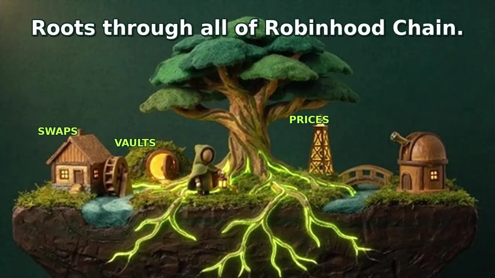

# What is Oak?

Oak gives your AI agent one connection to explore and use 25 configured projects on Robinhood Chain.
You can ask it to check balances, look up project information or prepare an action,
without connecting each project separately.

The illustration represents those configured integrations, not every project on the chain.

## Who it is for

If you use an AI app, Oak lets that app work with blockchain tools through a local
connection called MCP — an agent tool connection. You still decide which actions to approve.
If you build agents, the same connection gives you 102 tools with consistent inputs
and one local wallet. You can build your own workflows or autonomous setups.

The tree's roots connect the village in our artwork. Oak plays that connecting role
for the [25 configured projects](robinhood-chain-projects.md), including swaps, vaults, bridging,
research, names and agent identities. Pons token launches are one example.

## Your first five minutes

1. **Install and connect.** Use [the guide for your AI app](client-setup/README.md).
   Oak creates a wallet on your computer automatically. You do not need a wallet creation command.
2. **Ask for a read.** Try: “Show my public wallet address, network, balances and positions.”
   Reads do not require a subscription or public agent identity once hosted access opens.
3. **Learn before funding.** Check the network and address. Explore the [offline examples](../examples/README.md).
   At launch, send a little ETH for network fees and USDG for a subscription only when you want paid actions.

**Today:** the npm packages are published, but hosted actions are limited to the Oak team
until the token and subscription launch. You can install, connect, see your local
wallet address and run fixture examples; hosted calls may report unavailable access.

## Before your agent acts

Oak prepares a preview — an estimate of wallet changes — and checks the transaction
on your machine. Your app shows the transfers, approvals, destinations and estimated
gas cost. An approval is permission for a contract to spend a stated token amount.
You confirm before Oak signs locally by default. Declining or a missing confirmation
form stops signing. Oak rechecks the exact transaction immediately before it signs.

Your private key — your wallet's signing secret — stays on your machine.
The hosted Oak service does not hold that key or sign and send your transactions.
An owner can deliberately enable unattended operation in their own terminal;
that skips human prompts while retaining the local checks. See [security](security.md).

## What it cannot do

Oak cannot recover a lost wallet key, decide what you should buy, or promise an outcome.
A preview cannot prove that a token can later be sold or that a bridge or external
relayer will finish. Project rules, network changes and computer compromise still matter.
There is no completed third-party audit and no daily spending cap.
Never give an agent your private key, recovery words or wallet files.

## What it costs at launch

Installing the npm packages has no licensing charge. Public hosted actions require
an agent identity — an on-chain agent record — and an active subscription.
Registering an identity publishes its profile and costs ETH network fees;
linking an existing identity needs its owner's signature and no network fee.
Your agent must explain these steps and get permission first.

- **No-hold plan:** 12.333333 USDG per 30 days during the launch curve, without needing OAK tokens.
  USDG is the payment token. After launch graduation and warmup, this plan is repriced at each renewal.
- **Holder plan:** opens after graduation and 30 minutes of pool history. It costs
  9 USDG per 30 days, requires holding the quoted OAK amount, and permanently removes
  5% of that entry amount once at sign-up. Renewals do not remove more OAK.

Both plans wait during the 30-minute warmup. ETH network fees and project fees are
separate; Oak adds no per-call or trade fee. Running Oak can trigger renewals near
expiry, with human confirmation in default ask mode. Cancelling ends access
immediately and forfeits unused paid days. Holding OAK buys access and nothing else.
[Full plan terms](access-and-pricing.md)

Oak is independent and is not affiliated with Robinhood. Oak shows a region notice;
you and the operator are responsible for local compliance.
